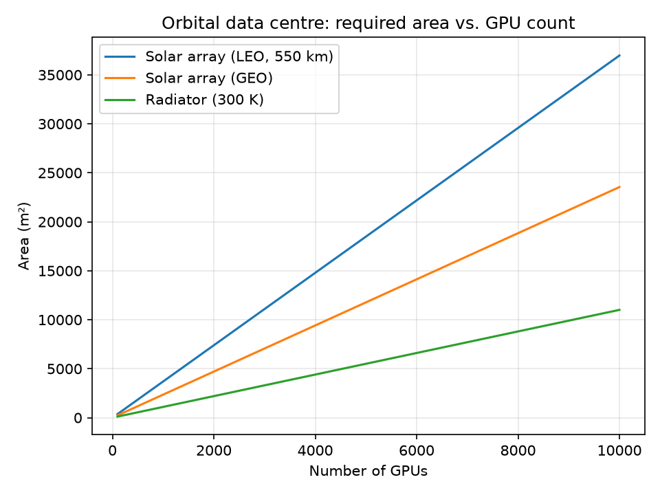

# Orbital Data Centre Sizer

A Python project that performs various calculations needed for planning an orbital data centre. Given a number of GPUs and an orbit, it can estimate the solar array, battery, and radiator needed.

## Why

I did some research on orbital data centres back in 2025 during my remote internship with Madari Space, and I wanted to turn that research into numbers. This is a side project that I wanted to try because of my interest in space.

## How to run

    pip install -r requirements.txt
    python plots.py      # generates results.png
    pytest               # runs the tests

## Results

From the results, LEO needs ~57% more array area than GEO because of frequent eclipses. The radiator is ~1,100 m² per 910 kW. And the radiator area falls steeply with temperature, since radiated power scales with T⁴.

## Assumptions

- Circular orbits, worst-case eclipse (orbit lined up with the Sun)
- 30% solar cell efficiency, 1,361 W/m² sunlight
- 90% battery efficiency, 150 Wh/kg
- Depth of discharge: 0.3 in LEO, 0.7 in GEO
- 30% power overhead on top of the GPUs
- Two-sided radiator, emissivity 0.9, 300 K

## Limitations

- Ignores sunlight and Earth's infrared hitting the radiator, so the real radiator would be larger, especially in LEO
- Ignores the mass of solar arrays, radiators and structure
- No solar cell degradation over time
- No launch cost

## Files

- orbit.py: orbital period and eclipse duration
- power.py: power load, solar array and battery sizing
- thermal.py: radiator sizing
- plots.py: generates the chart
- test_sizing.py: tests